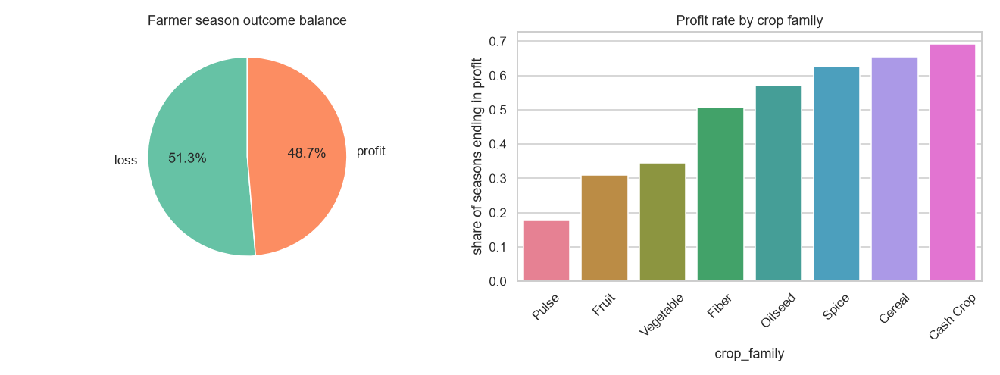
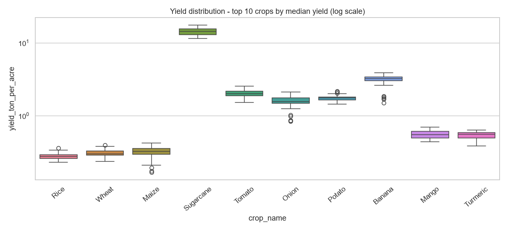
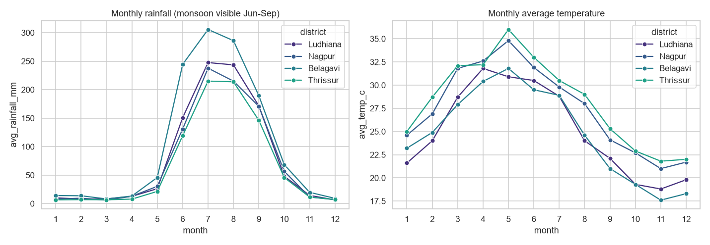
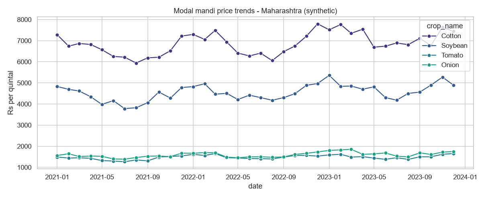
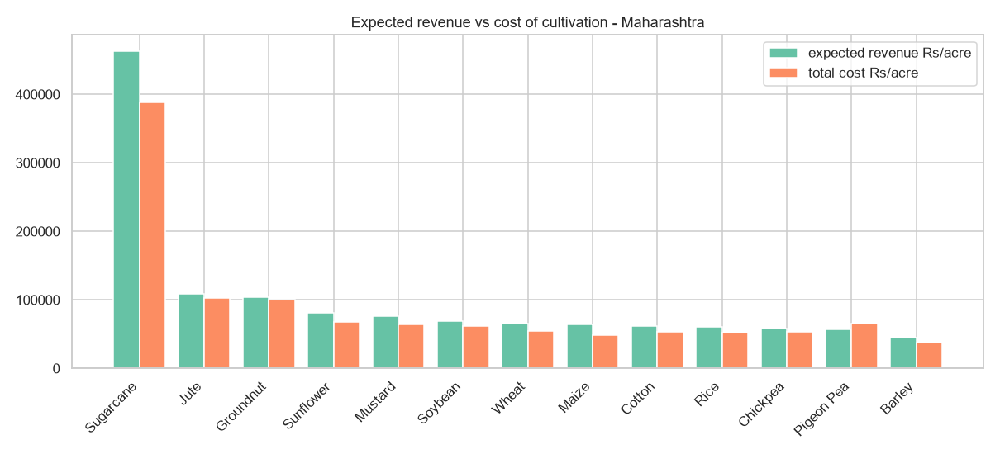
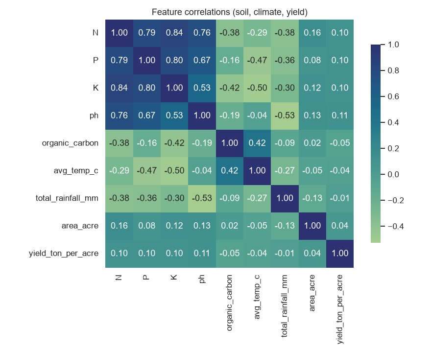

# AI Crop Recommendation System

Helps a farmer decide the most **profitable** crop to sow next season. Given soil
type, location (state + district), the previous crop and its outcome, the system
returns a **ranked Top-3 crop list** with predicted yield, market price, cost of
cultivation, net profit per acre and a plain-language reason.

> **Note:** all soil/weather/market data in this repo is **synthetically
> generated for demo purposes** - it is not real government data. Swap in real
> sources for production (see [Real data sources](#real-data-sources-for-production)).

> **Prototype notice:** this project is a **working prototype** built to
> demonstrate the end-to-end architecture (synthetic data -> ML training ->
> ranking API -> UI). The numbers it produces are illustrative only and should
> not be used for real farming decisions.

## Migration status

We are migrating the crop recommendation system step by step from synthetic demo data to real, key-free public data for all of Andhra Pradesh, with history from 2010.

- [x] **Chunk 01: Housekeeping & Configuration** - Branch `chunk-01-housekeeping`, `backend/config.py` using `pydantic-settings` (`DATABASE_URL`, `MODEL_DIR`, timeouts), `.env.example`, `.gitignore` entries for `.env` and local DB files, pytest test suite with FastAPI `TestClient` for `/api/meta` and `/api/recommend`.
- [ ] **Chunk 02: PostgreSQL & SQLAlchemy 2 Setup** - PostgreSQL connection configuration, SQLAlchemy 2 models and migration setup.
- [ ] **Chunk 03: Andhra Pradesh Spatial & Geocoding Grid** - Geocoding and spatial reference mapping for all Andhra Pradesh districts and mandals.
- [ ] **Chunk 04: ISRIC SoilGrids Integration** - Fetching real soil properties (pH, organic carbon, clay, sand) via key-free ISRIC SoilGrids REST API.
- [ ] **Chunk 05: Historical Climate Data (2010–Present)** - Historical climate series ingestion via Open-Meteo Archive / NASA POWER APIs.
- [ ] **Chunk 06: Weather Forecasting Integration** - Ingesting upcoming seasonal weather forecasts via Open-Meteo Forecast API.
- [ ] **Chunk 07: Market Price & Mandi Trends** - Ingestion of historical mandi prices and cost of cultivation for Andhra Pradesh crops.
- [ ] **Chunk 08: Unified Feature Engineering Pipeline** - Transforming and merging real soil, climate, and mandi price data from 2010 into model features.
- [ ] **Chunk 09: Model Retraining - Stage 1 (Agro-Climatic Suitability)** - Train and evaluate binary suitability model on real Andhra Pradesh data.
- [ ] **Chunk 10: Model Retraining - Stage 2a (Yield Prediction)** - Train and evaluate yield regression model on Andhra Pradesh harvest history.
- [ ] **Chunk 11: Model Retraining - Stage 2b (Market Price Forecasting)** - Train and evaluate price forecasting model on real mandi price trends.
- [ ] **Chunk 12: End-to-End System Integration & UI Verification** - Full system verification, Andhra Pradesh district selector integration, and deployment validation.

## Data exploration (generated charts)

Run `python ml/visualize_data.py` (needs `matplotlib` + `seaborn`, both in
`requirements.txt`) to regenerate all charts into `reports/`. The six charts
below summarize the synthetic dataset used to train the models.

### 1. Season outcomes
Profit/loss balance across all simulated farmer seasons, and profit rate per
crop family (pulses and oilseeds are structurally riskier in this dataset).



### 2. Yield distribution
Spread of yields per crop (log scale) - the signal the Stage 2a regressor learns.



### 3. Climate normals
Monthly rainfall and temperature per representative district; the Jun-Sep
monsoon drives Kharif vs Rabi suitability.



### 4. Market price trends
Three years of synthetic mandi prices with seasonal dips at harvest and mild
year-over-year inflation - the signal the Stage 2b price forecaster learns.



### 5. Economics
Expected revenue vs cost of cultivation per acre - the basis of the profit
ranking. Sugarcane dominates gross revenue; several crops hover near break-even,
which is why the profit/loss labels are balanced.



### 6. Feature correlations
Soil nutrients, climate and yield correlations used by the models.



## Quick start

```bash
pip install -r requirements.txt

python synthetic_data_generator/generate.py   # 1. generate CSVs into data/
python ml/train_suitability.py                # 2. train Stage 1
python ml/train_yield.py                      # 3. train yield model
python ml/train_price.py                      # 4. train price model

run.bat                                       # Windows: start server + open UI
# or manually:
python -m uvicorn backend.main:app --port 8000
```

Then open **http://127.0.0.1:8000** in your browser.
(Opening `frontend/standalone/index.html` directly from disk will NOT work -
the frontend must be served by the backend so it can call `/api/*`.)

## Architecture

```
+----------------------------------------------------------------------+
| 1. DATA LAYER                                                        |
|    synthetic_data_generator/generate.py -> data/*.csv                |
|    (soil, weather, crop_master, yield history, market prices,        |
|     cost of cultivation, farmer seasons)                             |
+----------------------------------------------------------------------+
| 2. FEATURE & TRAINING LAYER                                          |
|    ml/features.py           joins raw tables -> model-ready features |
|    ml/train_suitability.py  Stage 1  (RandomForest, binary suitability|
|                                      scored per candidate crop)      |
|    ml/train_yield.py        Stage 2a (GBR, yield t/acre)             |
|    ml/train_price.py        Stage 2b (GBR on lag/seasonal features)  |
|    ml/rank_profit.py        Stage 2c profit ranking + rotation rule  |
|                             + personalization                        |
|    models/                  *.pkl artifacts + metadata.json          |
+----------------------------------------------------------------------+
| 3. BACKEND / API LAYER (FastAPI)                                     |
|    backend/main.py            app entrypoint, serves frontend at "/" |
|    backend/config.py          pydantic-settings (DB, model dir, timeouts) |
|    backend/routers/recommend.py  POST /api/recommend                 |
|    backend/routers/history.py    GET/POST /api/history               |
|    backend/routers/meta.py       GET /api/meta                       |
|    backend/db.py              SQLite / Postgres persistence          |
|    backend/inference.py       loads models once at startup           |
+----------------------------------------------------------------------+
| 4. FRONTEND LAYER                                                    |
|    frontend/standalone/index.html                                    |
|    Single-file React + Tailwind app served by FastAPI (no Node build)|
+----------------------------------------------------------------------+
```

### Request flow

`form submit -> POST /api/recommend -> look up region soil/weather/market
features -> Stage 1 scores all 20 crops for agro-climatic suitability,
shortlists top-8 -> Stage 2 predicts yield + price per candidate ->
profit = yield x price - cost -> rotation rule (same crop family as
previous_crop => profit x 0.85) -> personalization (+/-5% based on the
farmer's own logged profit/loss with that crop) -> sort by adjusted
profit -> Top-3 JSON -> ranked cards in the browser.`

### Design note on Stage 1

A multi-class `crop_name` classifier is unlearnable here because every
candidate crop at one location shares identical location-only features.
Stage 1 is therefore a **binary suitability classifier** evaluated once per
(location x candidate-crop) pair, using crop attributes as features; the
top-k probabilities form the shortlist. This is recorded in
`models/metadata.json`.

## API examples

```bash
curl -X POST http://127.0.0.1:8000/api/recommend ^
  -H "Content-Type: application/json" ^
  -d "{\"farmer_id\":\"F1023\",\"soil_type\":\"Black\",\"state\":\"Maharashtra\",
       \"district\":\"Nagpur\",\"previous_crop\":\"Cotton\",
       \"previous_outcome\":\"loss\",\"previous_profit_amount\":-3200}"

curl http://127.0.0.1:8000/api/history/F1001
curl http://127.0.0.1:8000/api/meta
```

Interactive docs: http://127.0.0.1:8000/docs

## Regenerating data / retraining models

- Data: `python synthetic_data_generator/generate.py` (fixed seed = 42;
  prints row counts, missing values and profit/loss balance ~49%/51%).
- Models: run the three training scripts; each prints accuracy/F1 or RMSE/MAE
  and updates `models/metadata.json`.
- Delete `backend/app.db` to re-seed farmer history from CSV on next startup.

## Project layout

```
crop-recommendation-system/
|-- README.md
|-- requirements.txt
|-- .env.example                configuration template
|-- run.bat                     one-click launcher (Windows)
|-- tests/                      pytest test suite (FastAPI TestClient)
|-- synthetic_data_generator/generate.py
|-- data/                       generated CSVs
|-- ml/                         features + training + ranking pipeline
|-- models/                     trained artifacts + metadata.json
|-- backend/                    FastAPI app (routers, db, inference, config)
`-- frontend/standalone/        single-file React + Tailwind UI
```
plus `reports/` - generated EDA charts (embedded in the section above).

## Real data sources (for production)

- Soil: Soil Health Card Portal (soilhealth.dac.gov.in), ISRO Bhuvan soil API
- Weather: IMD, Open-Meteo, OpenWeatherMap
- Market prices: Agmarknet / data.gov.in mandi price API
- Cost of cultivation / MSP: DES (eands.dacnet.nic.in)
- Baseline soil-to-crop training set: Kaggle "Crop Recommendation Dataset" (ICFA)

Replace the corresponding loaders in `ml/features.py` and the generator with
these feeds; the two-stage pipeline itself stays unchanged.

## Assumptions

- Synthetic yields/prices/costs are internally consistent (costs are derived
  from realistic yield x price with a variable margin factor) so models learn
  real signal rather than noise.
- Kharif harvest month approximated as October, Rabi as April, for price
  forecasting targets.
- Personalization uses only the farmer's own logged seasons; new logs written
  via POST /api/history feed back into future recommendations.
